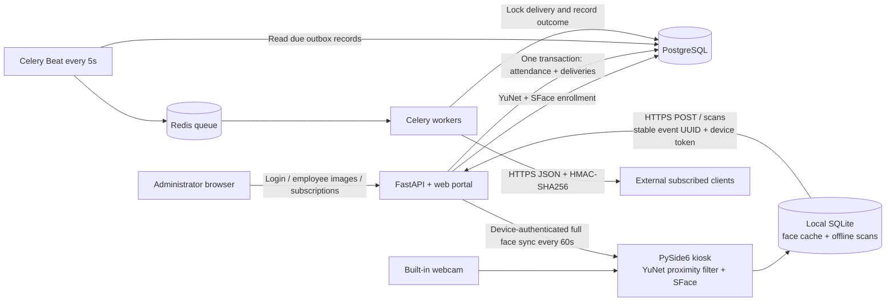

# Decoupled Face Recognition Attendance

A reference system with a central FastAPI administration portal and a native PySide6 kiosk for macOS and Windows. The kiosk opens directly into scanning. Administrators enroll employees on the web; kiosks periodically synchronize SFace embeddings, recognize locally, persist scans, and send them to the central API. Redis/Celery delivers signed webhooks from a database outbox.

For third-party HR/ERP integrations, see **[the integration API guide](docs/API.md)** or open **API Documentation** in the admin portal. The portal includes copyable cURL examples, an authenticated guide download, a portable Postman collection, and links to the live `/docs` and `/openapi.json` reference. Integrations currently use full administrator sessions (eight-hour expiry); attendance reads return the latest 200 records, so use signed webhooks for continuous capture.

## Architecture



1. Admin captures a photo in the browser or uploads a one-face image, reviews the preview, and registers it. Server derives normalized 128-dimensional embeddings; raw photos are not retained. Up to five embeddings per employee are stored.
2. A provisioned kiosk fetches active employees over HTTPS with its unique, revocable device token. A full snapshot replaces its cache, including removals. Both sides use the same model version.
3. The kiosk highlights only faces at least 20% of frame width and 25% of frame height. More than one near face pauses recognition. A cosine score of at least 0.50, a runner-up margin of 0.08, and three consecutive matches are required. These defaults need calibration with your cameras and workforce.
4. A recognized scan is saved in local SQLite before upload; a per-person 30-second local cooldown prevents a stationary face generating an event every frame. The network worker wakes immediately and retries during outages. UI says **Scan saved**, because central delivery may still be pending.
5. `POST /api/kiosk/scans` atomically writes attendance and a delivery per active subscriber. `(kiosk_id, event_id)` is unique; resending the same offline event is safe. Device tokens authenticate trusted kiosk software; the API does not independently verify a face from a submitted employee ID.
6. Beat reads due delivery rows every five seconds. Workers lock each delivery in PostgreSQL and send it. Failures retry six total attempts with `5 × 2^(attempt−1)` seconds plus 0–3 seconds jitter. After the sixth failure, state becomes `failed`. Queue loss is recoverable from pending database rows.
7. External clients must deduplicate by `X-Attendance-Delivery`. A worker can crash after a remote success but before committing, causing a repeat. Delivery is **at least once**.

## Repository

- `backend/main.py`: API, enrollment, browser portal and access checks; interactive API reference at `/docs`.
- `backend/db.py`: schema for users, admin sessions, employees, kiosks, attendance, subscriptions and deliveries.
- `backend/worker.py`: signed, asynchronous outbox delivery and retry scheduling.
- `backend/static/index.html`: administration, registration, device provisioning, subscriptions/tests and delivery monitor.
- `shared/vision.py`: identical enrollment/recognition feature pipeline.
- `kiosk/app.py`: scanner UI, PIN-protected settings, camera thread and separate network worker.
- `kiosk/storage.py`: private local SQLite face cache and durable scan queue.
- `docs/schema.sql`: generated PostgreSQL schema.
- `docs/macos-build.md`: development and signed `.app` build instructions.

## Run the central service

Use Python 3.12. From this repository root:

```sh
python3.12 -m venv .venv
source .venv/bin/activate
python -m pip install -r requirements.txt
cp .env.example .env
```

Edit `.env`, setting a real database password and your allowed webhook destination hostnames. `.env` is ignored by Git. Export its variables in the shell running the API, worker and Beat (the sample file contains shell-compatible values):

```sh
set -a
source .env
set +a
export POSTGRES_PASSWORD='replace-with-your-database-password'
docker compose up -d
python scripts/download_models.py
python -m backend.manage init
python -m backend.manage create-admin
uvicorn backend.main:app --host 127.0.0.1 --port 8000
```

Use the same password in `POSTGRES_PASSWORD` and `DATABASE_URL` (URL-encode special characters in the URL). Set `POSTGRES_PASSWORD` before every Compose command. Start these in **two additional terminals** with the virtualenv activated and the same `.env` variables exported:

```sh
celery -A backend.worker.celery worker --loglevel=info
```

```sh
celery -A backend.worker.celery beat --loglevel=info --schedule /tmp/attendance-celerybeat
```

Run one Beat scheduler. Open [the local portal](http://localhost:8000), sign in, and add an employee. In **Face registration**, select the employee and choose **Use camera** or **Upload photo**, review the image, then click **Register face**. Browser camera capture requires HTTPS or localhost and camera permission; if the desktop kiosk holds the webcam exclusively, close it first or upload a photo. The camera stops after capture, closing the dialog, switching sections, or hiding the tab. Photos are not sent until **Register face** is clicked. In **Kiosks**, create a device and save its token when shown. In **Webhooks**, add an allowlisted HTTPS endpoint, save the one-time signing secret, send a test, and inspect **Delivery monitor**.

SQLite is an automatic local development fallback when `DATABASE_URL` is unset. Use PostgreSQL for deployed API/workers: its row locks serialize duplicate kiosk submissions and concurrent delivery workers. `init` creates tables only; schema upgrades require reviewed migrations (for example Alembic).

## Run the kiosk

Create a separate Python 3.12 environment if the kiosk runs on another computer:

```sh
python3.12 -m venv .venv-kiosk
source .venv-kiosk/bin/activate
python -m pip install -r kiosk/requirements.txt
python scripts/download_models.py
python -m kiosk.app
```

On first launch, an operator uses **⚙** to set and confirm a PIN of at least six digits and enter the API origin, device token and camera index (`0` normally). This is a one-time device setup, not an attendee login. Pre-provision the kiosk before making it publicly accessible. Later launches open directly into the camera. Settings require the PIN; five failures cause a one-minute delay. Use `http://localhost:8000` only for same-machine development; other connections require HTTPS.

The face snapshot refreshes every 60 seconds. During outages the cache works for up to 24 hours from the last sync, then scanning stops until reconnection. Device revocation clears the cache at the next successful server contact. Removing an employee takes effect after the next sync; queued events for an inactive employee are rejected centrally. Permanent HTTP 4xx errors (except 429) are retained in `scans.error` for administrator review rather than retried forever. Pending or rejected events prevent switching deployment/device identity until the queue is drained or archived by an operator.

The kiosk includes a camera guide, live clock, connection indicator, and distinct visual states for checking, success, unknown faces, multiple people and errors. An ascending chime plays after a recognized scan is durably saved locally (central upload may still be pending). A descending tone plays after an unknown nearby face remains for 1.5 seconds, once per presence; it re-arms only after the scanning area clears for two seconds. Empty-camera frames stay silent. The 30-second scan cooldown also suppresses repeat success chimes. In PIN-protected settings, use **Audio feedback** to disable sounds or preview the success chime. Audio uses bundled original PCM tones and the system output volume; macOS uses `afplay`, Windows uses asynchronous `winsound`, and Linux uses an available platform player or a system beep.

Data locations:

- macOS: `~/Library/Application Support/AttendanceKiosk/kiosk.db`
- Windows: `%LOCALAPPDATA%\AttendanceKiosk\kiosk.db`
- Linux development: `~/.local/share/attendance-kiosk/kiosk.db`

The directory/database are restricted to the local OS user on Unix. On Windows provision the kiosk under a dedicated account and restrict the directory ACL. The current reference stores tokens/embeddings in SQLite without application-level encryption; use OS disk encryption and add Keychain/Credential Manager protection for production. The PIN protects in-app configuration, not the OS, files, quitting, or physical access. No live video is uploaded or retained.

## API and payload

| Endpoint | Authentication | Purpose |
| --- | --- | --- |
| `POST /api/login`, `POST /api/logout` | Login credentials / admin bearer | Eight-hour opaque administrator session |
| `GET/POST /api/admin/users` | Admin bearer | List/create admin users |
| `PATCH /api/admin/users/{id}?active=false` | Admin bearer | Disable admin access |
| `GET/POST /api/admin/employees` | Admin bearer | List/create employees |
| `POST /api/admin/employees/{id}/faces` | Admin bearer | Multipart `file` image enrollment |
| `PATCH /api/admin/employees/{id}?active=false` | Admin bearer | Disable employee |
| `GET/POST /api/admin/kiosks` | Admin bearer | List/provision devices; token shown once |
| `PATCH /api/admin/kiosks/{id}?active=false` | Admin bearer | Revoke a device |
| `GET /api/kiosk/faces` | Device bearer | Active employee snapshot + model version |
| `POST /api/kiosk/scans` | Device bearer | Idempotent attendance ingestion |
| `GET /api/admin/attendance` | Admin bearer | Last 200 logs |
| `GET/POST /api/admin/subscriptions` | Admin bearer | List/create webhook clients |
| `PATCH /api/admin/subscriptions/{id}?active=false` | Admin bearer | Pause client; pending deliveries cancel when processed |
| `POST /api/admin/subscriptions/{id}/test` | Admin bearer | Queue a signed test event |
| `GET /api/admin/deliveries` | Admin bearer | Last 200 delivery states/errors |

All timestamps are Unix seconds in UTC. Example scan:

```json
{
  "event_id": "4d406b5f-566d-41dc-b115-c2835daa052f",
  "employee_id": "6c824b0a-984b-45a1-9c63-9795987fbbe0",
  "captured_at": 1792560000.0,
  "confidence": 0.73,
  "model_version": "sface-2021dec-yunet-2023mar-v1"
}
```

Webhook JSON contains `id` (central attendance UUID), `type: attendance.recorded`, `employee: {id, code, name}`, `kiosk_id`, `captured_at`, `received_at`, and `confidence`. A test payload has `type: webhook.test` and `created_at`.

Receiver verification must use the **raw request bytes**, not parsed/re-serialized JSON:

```python
import hashlib
import hmac
import time

def valid_webhook(secret, timestamp_header, signature_header, raw_body):
    try:
        timestamp = int(timestamp_header)
    except (TypeError, ValueError):
        return False
    if abs(time.time() - timestamp) > 300:
        return False
    message = timestamp_header.encode() + b'.' + raw_body
    expected = 'v1=' + hmac.new(secret.encode(), message, hashlib.sha256).hexdigest()
    return hmac.compare_digest(expected, signature_header or '')
```

Headers: `X-Attendance-Timestamp`, `X-Attendance-Signature: v1=<hex>`, `X-Attendance-Delivery: <UUID>`. Verify the signature and timestamp, transactionally deduplicate the delivery UUID with your receiver's work, then return 2xx. Retries use fresh signatures/timestamps and the same delivery ID. Redirects are not followed; all non-2xx results count as a failure. No response body is stored. Subscriptions share the same `attendance.recorded` event type; event filters and manual replay are extension points.

## Validation and deployment boundaries

```sh
python -m pytest -q
python -m compileall -q backend kiosk shared scripts
python -m scripts.schema > docs/schema.sql
node --test tests/test_portal_camera.cjs
QT_QPA_PLATFORM=offscreen python -m pytest -q tests/test_kiosk_feedback.py
```

Tests cover device/admin boundaries, idempotent scan ingestion plus outbox creation, revocation, inactive employees, signed retries, success deduplication, exhausted retries, ambiguous face matches, and offline queue persistence. The default suite uses SQLite with mocked HTTP. To include concurrent scan tests, set `TEST_DATABASE_URL` to an **empty, isolated PostgreSQL test database**; the fixture creates and drops its tables.

Validation in this workspace: all nine tests passed against an isolated PostgreSQL 17 instance, including simultaneous duplicate submissions; the default suite passed eight tests with the PostgreSQL concurrency test skipped. Both ONNX models loaded and detected no faces in a blank frame. The kiosk UI initialized and closed successfully using Qt's offscreen platform. PyInstaller produced an Apple Silicon `dist/AttendanceKiosk.app`. Redis restart recovery, actual webhook receivers, camera accuracy and native permissions still need integration testing on deployment hardware. The current test dependencies emit an upstream Starlette warning about its HTTPX-based test client.

Before a real rollout:

- Terminate HTTPS at a reverse proxy; bind API/DB/Redis privately. Rate-limit `/api/login`, cap request bodies, restrict the admin portal network, and add SSO/MFA and audit logging as appropriate. All web administrators currently have equal privileges.
- Enforce outbound firewall/proxy restrictions for webhook workers. The allowlist and public-IP DNS checks prevent common mistakes, but DNS re-resolution in the HTTP transport means application checks alone do not prevent DNS rebinding. Do not allow destinations controlled by untrusted parties without hardened egress.
- Use encrypted database/storage backups, a managed secret store or encryption for webhook signing secrets, and an explicit biometric retention/deletion policy. Only token hashes and password/PIN hashes are stored centrally; webhook secrets must remain recoverable for signing.
- Face-size filtering estimates proximity and three-frame agreement improves stability; neither provides depth measurement or liveness/anti-spoofing. Add a validated liveness/depth solution if printed photos or phone replays are in scope. Calibrate false accept/reject rates rather than treating cosine scores as probabilities.
- Add monitoring/alerts for failed deliveries and rejected kiosk scans, migrations, retention jobs, credential/secret rotation, fleet updates, and a restart policy for API/Beat/workers. Attendance records are raw scan events; payroll shifts, check-in/out inference and cross-kiosk deduplication are separate business rules.

## Primary references

- [OpenCV YuNet/SFace detection and recognition pipeline](https://docs.opencv.org/4.13.0/d0/dd4/tutorial_dnn_face.html)
- [Celery task retry behavior](https://docs.celeryq.dev/en/v5.4.0/userguide/tasks.html)
- [PyInstaller build and signing options](https://www.pyinstaller.org/en/stable/usage.html)
- [OpenCV Zoo model sources and licenses](https://github.com/opencv/opencv_zoo/tree/main/models)

The model downloader uses upstream `main`, verifies fixed SHA-256 hashes, and prints the verified values. Review the model licenses before distributing. Python dependency ranges are compatibility bounds; freeze and audit an environment-specific lockfile for releases.
